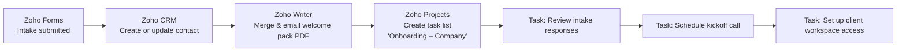

# Client Onboarding Automation

**Standardize intake first, then automate intake → welcome doc → task assignments.**
Reduced client onboarding from about **3 hours** of manual admin to about **25 minutes** per client.

Built with **Zoho Forms · Zoho Flow · Zoho CRM · Zoho Writer · Zoho Projects**.

     

---

## The problem

Every new client meant the same manual routine:

1. Collect details over email and calls, in a different format each time
2. Re-type the client into the CRM
3. Copy the last client's welcome doc and edit names and dates by hand
4. Export it to PDF and email it
5. Create the project tasks from memory
6. Chase whatever was missing from the intake

It was slow, error-prone, and inconsistent from client to client.

## The approach

### 1. Standardize intake (Zoho Forms)

One intake form replaces free-form emails. Required fields stop onboarding from starting with gaps, and the service package is a fixed list so every later step can rely on it. See [`docs/intake-form.md`](docs/intake-form.md).

### 2. Automate the hand-offs (Zoho Flow)

One form submission triggers seven steps, which finish in about 3 seconds:

Step-by-step configuration: [`docs/flow-steps.md`](docs/flow-steps.md).

### 3. Personalized welcome pack (Zoho Writer)

A merge template fills in the client's name, company, package, start date and goals, then emails the result as a PDF. See [`templates/welcome-pack-template.md`](templates/welcome-pack-template.md).

## Results

| | Before | After |
|---|---|---|
| Time per new client | ~3 hours | ~25 minutes |
| Data entry | Re-typed into each tool | Entered once by the client |
| Welcome document | Edited by hand | Generated and emailed automatically |
| Onboarding tasks | Created from memory | Created and assigned automatically |
| Consistency | Varied per client | Identical for every client |

## Field mapping

| Intake field | Zoho CRM | Writer merge field | Zoho Projects |
|---|---|---|---|
| First / Last name | `First_Name`, `Last_Name` | `«First Name»` | – |
| Email | `Email` (match key) | Recipient address | – |
| Phone | `Phone` | – | – |
| Company name | `Department` | `«Company Name»`, PDF file name | Task list name |
| Service package | – | `«Service Package»` | – |
| Preferred start date | – | `«Start Date»` | – |
| Project goals | – | `«Project Goals»` | – |

## Sample run

A test client, *Ananya Rao of Bluepeak Consulting* (sample data), submitted the intake form. Zoho Flow completed all 7 steps in about 3 seconds:

| Step | App | Action | Result |
|---|---|---|---|
| 1 | Zoho Forms | Form entry submitted | ✅ |
| 2 | Zoho CRM | Create or update contact | ✅ Contact "Ananya Rao" created |
| 3 | Zoho Writer | Merge and email document | ✅ "Welcome Pack - Bluepeak Consulting.pdf" emailed |
| 4 | Zoho Projects | Create task list | ✅ "Onboarding - Bluepeak Consulting" |
| 5 | Zoho Projects | Create task | ✅ Review intake responses |
| 6 | Zoho Projects | Create task | ✅ Schedule kickoff call |
| 7 | Zoho Projects | Create task | ✅ Set up client workspace access |

<!-- Screenshots: add images to a screenshots/ folder and uncomment.

-->

## Possible next steps

- Branch the task list by service package (more tasks for Enterprise)
- Set due dates relative to the client's preferred start date
- Notify the account manager in Slack or Cliq when a new client arrives
- Add a follow-up email if the kickoff call isn't booked within 3 days

---

All client names and details shown are sample data.
